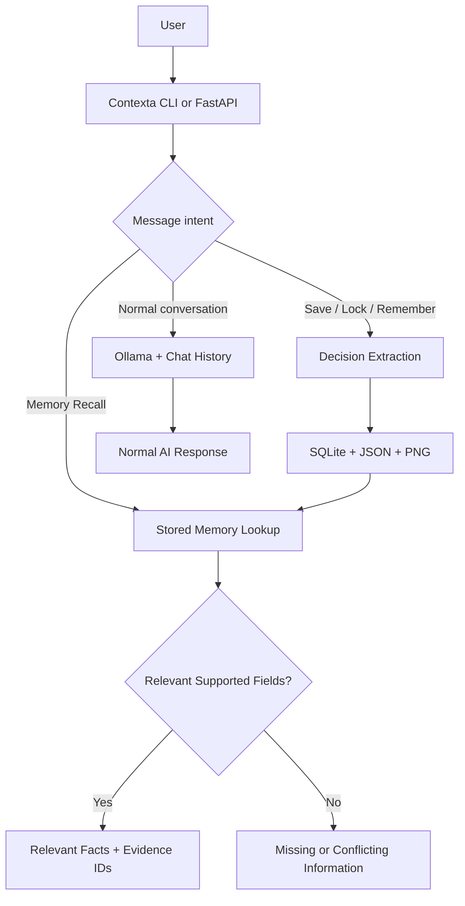
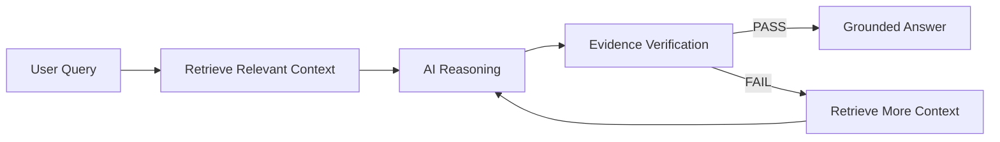

# Contexta

### Grounded Memory for AI Agents

Contexta is a terminal-native, model-agnostic context-memory layer for AI agents. It converts useful long-term context into compact visual artifacts with structured metadata, persists them, retrieves relevant evidence, and verifies that AI-generated claims are supported before returning an answer or action.

## Problem

AI agents become less reliable as long-term context grows. Repeatedly carrying large conversation histories increases token usage and latency while important information becomes harder to retrieve. When relevant context is missing or buried, models can lose previous decisions, produce unsupported claims, or hallucinate.

## Solution

Contexta provides people and AI agents with persistent memory through a CLI and MCP server. FastAPI exposes the same backend services to local clients.

The system:

1. Extracts useful information from raw context.
2. Normalizes it into structured facts.
3. Creates a compact image-based context artifact.
4. Stores structured JSON metadata and provenance alongside the artifact.
5. Persists the context for future retrieval.
6. Retrieves only context relevant to the current request.
7. Supplies verified context to the reasoning model.
8. Checks generated claims against retrieved evidence.
9. Retrieves additional context and re-reasons when a claim is unsupported.
10. Returns a grounded answer or action.

## Innovation

Contexta does not modify or retrain the underlying AI model. Instead, it adds a reusable memory and reliability layer around the model.

The core reasoning loop is:

`Retrieve → Reason → Verify → Recover → Reason`

The image representation is one part of the context architecture. Structured metadata provides searchable facts and provenance, while MCP provides a standardized interface for AI agents to access the memory capability.

## Core Architecture



## Reasoning Flow



## Context Artifact

Each stored context item consists of:

```text
Context
├── Image Artifact
├── JSON Metadata
├── Source / Provenance
├── Extraction method
├── Timestamp
└── Caller-supplied metadata
```

The PNG is a readable visual summary, not a token-compression guarantee. SQLite retains searchable text and provenance-backed facts; JSON metadata accompanies the PNG.

Example metadata:

```json
{
  "id": "generated-uuid",
  "content": "We chose PostgreSQL for Project Alpha.",
  "facts": [{"text": "We chose PostgreSQL for Project Alpha.", "category": "decision"}],
  "source": "planning-notes.txt",
  "metadata": {},
  "created_at": "UTC timestamp",
  "extraction_method": "ollama"
}
```

## MCP Tools

Contexta exposes four core MCP capabilities:

| Tool | Purpose |
|---|---|
| `store_context` | Extract, normalize and persist context |
| `retrieve_context` | Find relevant stored context |
| `verify_context` | Check claims against evidence |
| `inject_context` | Prepare verified context for reasoning |

MCP backend requests allow up to 120 seconds so local Ollama extraction can complete.

## Technology Stack

### Backend
- Python
- FastAPI
- SQLite
- Pillow
- argparse CLI

### AI
- Ollama
- Qwen3-VL 4B initial model; configurable Ollama model

### Agent Infrastructure
- Model Context Protocol
- Official TypeScript MCP SDK, stdio transport

### Testing
- Pytest
- Node.js test runner

### Hackathon Sponsor Technologies

Contexta targets the Open Agent Hackathon 2026 Reasoning Architecture track.

| Sponsor | Intended Contribution 
|---|---|---|
| Zetaris | External data federation and retrieval 
| Meterless / Nightshift | Optional inference or orchestration provider 
| Cursor | Development workflow | Usage must be documented separately 
| NVIDIA / Nemotron | Optional model inference or acceleration 

## Folder Structure

```text
Contexta/
├── backend/
│   ├── app/
│   │   ├── api/
│   │   ├── context/
│   │   ├── memory/
│   │   ├── reasoning/
│   │   ├── storage/
│   │   ├── verification/
│   │   ├── conversation.py
│   │   ├── cli.py
│   │   └── main.py
│   └── data/
│       └── artifacts/
├── mcp/
│   ├── src/
│   └── test/
├── tests/
├── .env.example
├── .gitignore
├── pyproject.toml
├── uv.lock
└── README.md
```

`uv.lock` is generated by `uv sync` after dependencies can be resolved.

## Data Flow

```text
Raw Context
    ↓
Extraction
    ↓
Normalization
    ↓
Image + JSON + Provenance
    ↓
Persistent Memory
    ↓
SQLite + FTS5 retrieval
    ↓
Relevant Evidence
    ↓
AI Reasoning
    ↓
Evidence Verification
    ↓
PASS → Grounded Answer / Action
FAIL → Retrieve More Context → Re-reason
```

## Security

Context can contain sensitive information, so Contexta treats context as data requiring controlled access.

The architecture supports:

- Provenance tracking
- Evidence-based answers
- Controlled retrieval
- Local model execution through Ollama
- Sends selected evidence only to the configured local Ollama endpoint
- Separation between stored context and model reasoning

Retrieved context and user questions are untrusted data, represented as JSON, and explicitly excluded from model instructions. Verification checks cited IDs, lexical evidence overlap, entity mismatches, and negation conflicts. This deterministic MVP verifier is not a substitute for expert review or a general semantic-entailment system.

## MVP Scope

The first working version focuses on one complete loop:

```text
Store Context
    ↓
Create Image + JSON
    ↓
Persist
    ↓
Retrieve
    ↓
Reason
    ↓
Verify
    ↓
Recover if Unsupported
    ↓
Return Grounded Answer
```

The initial implementation intentionally avoids unnecessary distributed infrastructure, multiple databases, multi-agent complexity, model fine-tuning, and excessive MCP tools.

## Example

Input:

> We decided to use PostgreSQL for Project X.

Contexta stores the decision as a context artifact.

Later:

> What database did we choose for Project X?

Contexta retrieves the relevant evidence:

```text
Project X → PostgreSQL
```

The reasoning model produces a claim:

```text
PostgreSQL
```

The verifier compares the claim with the stored evidence.

```text
PASS
```

The system returns:

> You decided to use PostgreSQL for Project X.

If the model instead claims:

```text
MongoDB
```

the verifier rejects the unsupported claim and triggers additional context retrieval before another reasoning attempt.

## Development Principle

Contexta is built around one principle:

> **The model should not have to remember everything. It should know how to retrieve what matters and prove that what it says is supported.**
